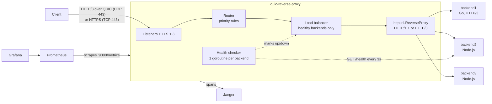

# QUIC Reverse Proxy

[](https://github.com/ManveerAnand/QUICK-reverse_proxy/actions/workflows/ci.yml)


[](LICENSE)

A reverse proxy and load balancer written in Go that accepts **HTTP/3 over QUIC**, terminates **TLS 1.3**, and forwards requests to a pool of backend servers. It checks backend health, takes failed servers out of rotation automatically, and exports metrics and traces to Prometheus, Grafana and Jaeger.

I built it to learn how HTTP/3 works below the API level: QUIC streams over UDP, the TLS 1.3 handshake, and how a proxy decides where each request goes.

## Features

| Area | What it does |
|---|---|
| **Transport** | HTTP/3 over QUIC (UDP :443) using [`quic-go`](https://github.com/quic-go/quic-go); HTTPS over TCP :443 for clients without HTTP/3; optional plain HTTP on :80 |
| **HTTP/3 discovery** | TCP responses carry an `Alt-Svc: h3=":443"` header, so browsers switch to HTTP/3 automatically |
| **TLS** | TLS 1.3 only, ALPN `h3`, optional 0-RTT resumption |
| **Routing** | Priority-ordered rules matching path (with `*` wildcards), path prefix, host, method and headers; optional prefix stripping |
| **Load balancing** | Set per backend pool: `round_robin`, `least_connections`, `weighted`, `ip_hash` |
| **Backends** | Forward over HTTP/1.1, HTTPS or HTTP/3 (`protocol: h3`) |
| **Health checks** | Active probes with healthy/unhealthy thresholds, plus passive ejection when a request hits a dead backend |
| **Observability** | Prometheus metrics, a ready-made Grafana dashboard, OpenTelemetry spans exported to Jaeger with W3C `traceparent` propagation, JSON logs |
| **Operations** | Graceful shutdown on SIGTERM; a small control API (:8889) to stop and start demo backends for failover testing |

## Architecture



**Life of a request**

1. **Accept.** The QUIC listener (or the TCP fallback) completes the TLS 1.3 handshake and hands the request to the handler. A tracing span starts here.
2. **Route.** Rules are sorted by `priority`; the first one that matches decides the backend pool. `/api/*` goes to `api-service`, for example.
3. **Pick a server.** The pool's algorithm chooses among healthy backends only. If none are healthy the client gets `503`.
4. **Forward.** `httputil.ReverseProxy` sends the request on, adding `X-Forwarded-For`, `X-Real-IP` and a `traceparent` header, and streams the response back.
5. **Fail fast.** If the backend can't be reached (connection refused, DNS failure, timeout), the client gets `502` and the backend is removed from rotation immediately. The active checker re-admits it after it passes enough probes in a row.

### Code layout

```
cmd/proxy/            entry point: config, telemetry, servers, graceful shutdown
internal/quic/        HTTP/3 server and client (quic-go), TLS config, Alt-Svc
internal/proxy/       router, load balancer, request handler, server wiring
internal/config/      YAML loading, defaults and validation
internal/telemetry/   Prometheus metrics, OpenTelemetry tracing, logging
internal/api/         control API for the failover demo
pkg/health/           active health checker
examples/             demo backends (Go HTTP/3 server, Node.js server)
configs/proxy.yaml    demo configuration used by docker-compose
monitoring/           Prometheus config, Grafana provisioning and dashboard
```

## Quick start

**Prerequisites:** Docker with Compose, `openssl`, and Go 1.24+ to run the tests.

```bash
# 1. Generate a self-signed certificate for localhost
make generate-certs

# 2. Start the proxy, 3 backends, Prometheus, Grafana and Jaeger
docker compose up -d --build
```

**Try it**

```bash
# Requests alternate between backend2 and backend3 (round robin)
curl -sk https://localhost/api/status

# The TCP response advertises HTTP/3
curl -skI https://localhost/api/status | grep -i alt-svc

# HTTP/3 end to end: client -> proxy over QUIC, proxy -> Go backend over QUIC
# (needs a curl built with HTTP/3 support)
curl -sk --http3-only https://localhost/h3/

# The same client IP always reaches the same backend (ip_hash)
curl -sk https://localhost/sticky/api/status

# Proxy and backend health as JSON
curl -s http://localhost/health
```

**Failover demo:** run `docker stop backend2`, then repeat the `/api/status` request. Every response now comes from backend3. Run `docker start backend2`, and about 6 seconds later (2 successful probes, 3 seconds apart) it is back in rotation.

| Service | URL |
|---|---|
| Grafana dashboard | http://localhost:3001 (admin / admin) |
| Prometheus | http://localhost:9091 |
| Jaeger traces | http://localhost:16686 (service `quic-reverse-proxy`) |
| Raw metrics | http://localhost:9090/metrics |

## Configuration

Everything is set in one YAML file (`configs/proxy.yaml`). A backend pool looks like this:

```yaml
backends:
  - name: "api-service"
    targets: ["http://backend2:3000", "http://backend3:3000"]
    protocol: "http"            # http | https | h3
    load_balancer: "round_robin"
    health_check:
      enabled: true
      path: "/health"
      interval: "3s"
      timeout: "2s"
      healthy_threshold: 2      # successes in a row to come back
      unhealthy_threshold: 2    # failures in a row to be removed

routing:
  default_backend: "api-service"
  rules:
    - path: "/api/*"
      backend: "api-service"
      priority: 100             # higher is checked first
      strip_prefix: false
```

| `load_balancer` | Picks | Good for |
|---|---|---|
| `round_robin` | Each backend in turn (lock-free atomic counter per pool) | Equal servers, similar requests |
| `least_connections` | The backend with the fewest requests in progress | Requests with very different durations |
| `weighted` | Random, in proportion to `weight` | Spreading load randomly (see limitations) |
| `ip_hash` | FNV-1a hash of the client IP, modulo pool size | Sticky sessions without cookies |

## Design notes

- **Why QUIC.** HTTP/2 multiplexes streams over a single TCP connection, so one lost packet blocks every stream until it is resent (head-of-line blocking). QUIC handles loss per stream, and it combines the transport and TLS handshakes into one round trip.
- **Why a TCP listener too.** Browsers always open a site over TCP first. The `Alt-Svc` header on those responses tells them HTTP/3 is available on UDP 443, and later requests switch over. TCP also covers networks that block UDP.
- **Health checks: active and passive.** Active probes catch backends that fail while idle. Passive ejection reacts within a single request. Thresholds stop one slow probe from flapping a backend in and out of rotation. Unreachable backends are detected by error type (`*net.OpError` on dial, DNS errors, timeouts), not by matching error strings, which differ between operating systems.
- **`ip_hash` hashes the full pool.** If the hash used only the healthy servers, the pool size would change whenever any server went down, and almost every client would move. Hashing over the full pool and stepping to the next healthy server means only the failed server's clients move. The hash uses the connection's address, not `X-Forwarded-For`, because clients can set that header to anything.
- **Concurrency.** Request handling runs one goroutine per request. Backend health and connection counts use `sync/atomic`; the pool map is guarded by an `RWMutex` and is never written while only the read lock is held.

## Testing

```bash
go test ./...
```

The suite covers a real HTTP/3 request over QUIC through the proxy, the `Alt-Svc` header, forwarding, `X-Forwarded-For` and trace propagation, `502` then `503` on a dead backend, every load-balancing algorithm (including 2,000 concurrent round-robin picks), and validation of the demo config. CI runs `go vet` and the tests with the race detector on every push.

## Limitations and next steps

- `ip_hash` uses `hash % N`, so adding a server remaps most clients. Consistent hashing would move only about 1/N of them.
- QUIC connection migration changes the client IP, which breaks `ip_hash` stickiness for mobile clients. Hashing on the QUIC connection ID would fix this.
- `weight` is set per pool, so every server in a pool has the same weight and `weighted` behaves like a uniform random pick. Per-target weights would make it useful for servers of different sizes.
- The `retry_count` setting is parsed but failed requests are not retried on another backend yet.
- The auth and rate-limit middleware in `internal/middleware` are not wired into the request path yet.
- Prometheus metrics cover HTTP traffic and backends. QUIC transport internals (RTT, packet loss, congestion window) are not exported yet.

## License

[MIT](LICENSE) © Manveer Anand
